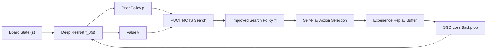
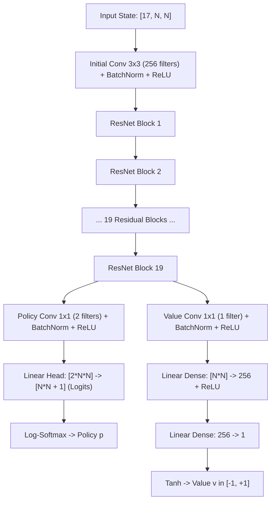
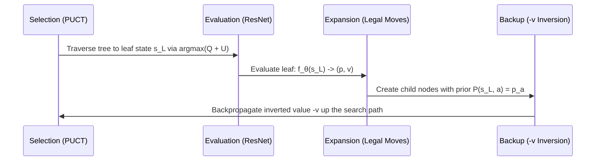
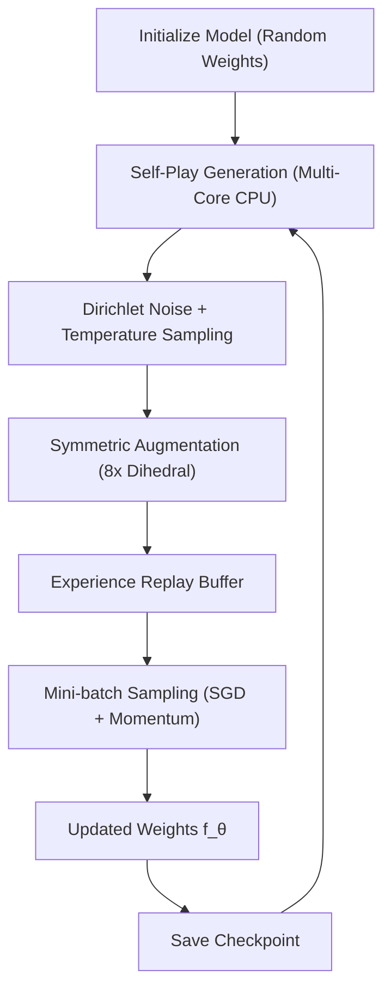

# OceanGo: AlphaZero Architecture & MCTS Mathematical Guide

This document provides a comprehensive, deep-dive explanation of the artificial intelligence architecture powering **OceanGo**. It details the mathematical foundations, neural network design, Monte Carlo Tree Search (MCTS) algorithm, and reinforcement learning self-play training loop inspired by DeepMind's seminal AlphaGo Zero and AlphaZero research.

---

## 1. High-Level Architecture Overview

OceanGo learns to play Go entirely through **reinforcement learning from self-play (Tabula Rasa)** without relying on human games, opening books, or handcrafted heuristics. The system consists of two tightly coupled engines:

1. **A Dual-Head Deep Residual Neural Network ($f_\theta$)**: Evaluates board positions to predict both:
   - **Policy ($\mathbf{p}$)**: Probability distribution over all legal moves.
   - **Value ($v$)**: Estimated game outcome from the current player's perspective ($v \in [-1, +1]$).
2. **Monte Carlo Tree Search (MCTS)**: Uses the neural network as an evaluation and exploration guide to search several moves ahead, building a search policy $\boldsymbol{\pi}$ that is significantly stronger than the raw neural network policy $\mathbf{p}$.

---

## 2. Input Representation: 17 Feature Planes

The state of a Go board cannot be fully understood from a single static snapshot because of rules involving **liberties, captured chains, and positional superko** (repetition of board states). OceanGo feeds the neural network an input tensor of shape:

$$\text{Shape: } [17 \times N \times N]$$

Where $N$ is the board dimension ($N = 9$ by default; also supports $13$ or $19$).

| Plane Index | Description | Purpose |
|:---:|:---|:---|
| **0 – 7** | Binary matrices of current player stones for time steps $t, t-1, \dots, t-7$ | Captures dynamic tactical history, captures, and recent tempo |
| **8 – 15** | Binary matrices of opponent stones for time steps $t, t-1, \dots, t-7$ | Provides full reciprocal historical context |
| **16** | All-ones matrix ($1.0$) if current player is Black (Player 1), or all-zeros ($0.0$) if White (Player 2) | Informs the network of turn color (Komi / First-mover advantage) |

### Canonical Player Perspective
The input planes are **always formatted from the perspective of the player whose turn it is to move**. Plane $0$ always contains the stones of the current player, and Plane $8$ always contains the opponent's stones. This symmetry allows a single neural network to play both Black and White without duplicate parameters.

---

## 3. Deep Residual Neural Network (ResNet)

The network architecture ($f_\theta$) maps the $17 \times N \times N$ state tensor into two heads: a **Policy Head** and a **Value Head**.

### Initial Convolution
- **Filter**: 256 channels, kernel size $3 \times 3$, padding $1$, stride $1$.
- Followed by **Batch Normalization** and **ReLU** activation.

### Residual Tower (19 Blocks)
Each residual block preserves gradient flow across deep layers using identity shortcut connections:
$$x_{l+1} = \text{ReLU}\left( x_l + \mathcal{F}(x_l, \mathcal{W}_l) \right)$$
Each block consists of:
1. $3 \times 3$ Conv (256 filters, stride 1, padding 1) $\to$ BatchNorm $\to$ ReLU
2. $3 \times 3$ Conv (256 filters, stride 1, padding 1) $\to$ BatchNorm
3. Skip connection: add input $x_l$
4. ReLU activation

### Policy Head
Predicts move probabilities over all $N \times N$ board intersections plus the **Pass** move ($N^2 + 1$ actions):
1. $1 \times 1$ Conv (2 filters, stride 1) $\to$ BatchNorm $\to$ ReLU
2. Flatten layer ($2 \times N \times N$)
3. Linear layer projecting to $N^2 + 1$ logits.
4. Softmax over legal moves:
   $$P(s, a) = \frac{\exp(\text{logit}_a)}{\sum_{b \in \text{legal}(s)} \exp(\text{logit}_b)}$$

### Value Head
Predicts the expected game outcome from the current player's perspective:
1. $1 \times 1$ Conv (1 filter, stride 1) $\to$ BatchNorm $\to$ ReLU
2. Flatten layer ($N \times N$)
3. Fully connected layer to 256 hidden units $\to$ ReLU
4. Fully connected layer to 1 scalar output $\to$ $\tanh$ activation
   $$v \in [-1.0, +1.0]$$
   - $+1.0$: Certain victory for current player.
   - $-1.0$: Certain defeat for current player.
   - $0.0$: Even / tie game.

---

## 4. Monte Carlo Tree Search (MCTS) with PUCT

While the raw neural network policy $\mathbf{p}$ provides quick intuition, MCTS acts as a powerful lookahead search that dramatically sharpens move selection.

### The 4 Phases of MCTS

#### Phase 1: Selection (PUCT)
Starting from root state $s_0$, the search traverses down the tree. At each internal node $s$, it selects the action $a^*$ that maximizes the **Predictor Upper Confidence Bound applied to trees (PUCT)**:

$$a^* = \arg\max_a \left( Q(s, a) + U(s, a) \right)$$

Where:
- **$Q(s, a)$**: Exploitation term. The mean action-value of all previous visits to action $a$:
  $$Q(s, a) = \frac{W(s, a)}{N(s, a)}$$
- **$U(s, a)$**: Exploration term. Encourages visiting moves with high neural network prior probability $P(s, a)$ that have not been explored often:
  $$U(s, a) = c_{puct} \cdot P(s, a) \cdot \frac{\sqrt{\sum_b N(s, b)}}{1 + N(s, a)}$$
- $c_{puct}$: Exploration constant (default $1.0$).

##### Exploration Dynamics
- When an action $a$ has never been visited ($N(s, a) = 0$), $U(s, a)$ is at its maximum and is directly proportional to the neural network's prior $P(s, a)$.
- As $N(s, a)$ increases, $U(s, a)$ decays toward zero, allowing the empirical value $Q(s, a)$ to dominate selection.

#### Phase 2: Evaluation
When traversal reaches an unexpanded leaf node $s_L$:
- If $s_L$ is terminal (game over via consecutive passes or full board), its true value $z \in \{-1, 0, +1\}$ is assigned using the exact Go area scoring rules engine.
- Otherwise, $s_L$ is evaluated by the neural network:
  $$( \mathbf{p}, v ) = f_\theta(s_L)$$

#### Phase 3: Expansion
For all legal moves $a \in \text{legal}(s_L)$, child nodes $s_{L+1} = \text{make\_move}(s_L, a)$ are instantiated, with their prior probabilities initialized to the masked softmax policy:
$$P(s_L, a) = \mathbf{p}_a, \quad N(s_L, a) = 0, \quad W(s_L, a) = 0, \quad Q(s_L, a) = 0$$
The node is marked as expanded.

#### Phase 4: Backup (Zero-Sum Inversion)
The evaluation value $v$ is backpropagated up the search path back to the root.

> [!IMPORTANT]
> **Two-Player Zero-Sum Value Inversion**: The neural network value $v$ is evaluated from the perspective of the player at leaf $s_L$. The action that led into $s_L$ was taken by $s_L$'s parent (the opponent). Therefore, the value of choosing this move from the parent's perspective is **$-v$**.
>
> In the backup loop, the value sign alternates at every step:
> $$\text{For child edge: } W \leftarrow W - v$$
> $$\text{For parent edge: } W \leftarrow W + v$$

---

## 5. Parallel Batched MCTS & Virtual Loss

To maximize GPU hardware utilization (on Apple Silicon MPS or NVIDIA CUDA) without distorting single-tree PUCT search paths, OceanGo separates **intra-tree batching** (`MCTS_BATCH_SIZE = 16`) from **cross-worker GPU server batching** (`GPU_SERVER_BATCH_SIZE = 512`).

To prevent multiple concurrent search paths in the same intra-tree batch from selecting the exact same leaf:
1. **Virtual Loss**: When a path selects a node during the batch collection phase, a virtual loss $\lambda = 1.0$ is immediately added:
   $$N_{temp} = N + \lambda, \quad W_{temp} = W - \lambda$$
   This temporarily decreases $Q(s, a)$, making the node look less attractive to concurrent search paths in the same batch and forcing them to explore alternative branches.
2. **Batch Evaluation**: Once leaves are gathered across workers, the central GPU server coalesces up to $512$ states and evaluates them in a single parallel tensor pass.
3. **Loss Removal & Backup**: Virtual loss is deducted, and the true evaluated value $v$ is backpropagated.

---

## 6. Self-Play Reinforcement Learning Loop

### 1. Dirichlet Exploration Noise
To ensure the self-play games explore diverse opening lines and novel tactical variations, Dirichlet noise is injected into the root node's prior probabilities:

$$P'(s_{root}, a) = (1 - \epsilon) P(s_{root}, a) + \epsilon \cdot \eta_a, \quad \boldsymbol{\eta} \sim \text{Dir}(\alpha)$$

- $\epsilon = 0.25$ (25% noise, 75% neural network prior).
- $\alpha$ scales inversely with board area: $\alpha = 0.15$ for 9x9, $\alpha = 0.06$ for 13x13, and $\alpha = 0.03$ for standard 19x19.

### 2. Temperature Decay ($\tau$)
After MCTS completes $M$ simulations for a move, visit counts $N(s, a)$ form the search policy:

$$\pi(a | s) = \frac{N(s, a)^{1 / \tau}}{\sum_b N(s, b)^{1 / \tau}}$$

- **Early Game (Opening Exploration)**: $\tau = 1.0$. Moves are sampled probabilistically proportional to visit counts for the first $T_{cutoff}$ moves, scaled to board size:
  - **9x9**: Moves 1 – 10
  - **13x13**: Moves 1 – 16
  - **19x19**: Moves 1 – 30 (DeepMind AlphaGo Zero default)
- **Mid & Late Game (Moves $> T_{cutoff}$)**: $\tau \to 0$ ($\tau \le 0.05$). The AI plays greedily:
  $$a = \arg\max_a N(s, a)$$
  Maximizing tactical precision and competitive execution.

### 3. Symmetrical Data Augmentation ($8\times$)
The game of Go possesses **8-fold dihedral symmetry ($D_4$)** consisting of 4 rotations ($0^\circ, 90^\circ, 180^\circ, 270^\circ$) and horizontal reflections.

Every self-play tuple $(s_t, \boldsymbol{\pi}_t, z)$ is expanded into 8 symmetric equivalents before being added to the replay buffer, multiplying training throughput by $8\times$ without additional GPU simulation overhead.

---

## 7. Loss Function & Neural Network Optimization

The neural network parameters $\theta$ are trained using **Stochastic Gradient Descent (SGD) with Momentum (0.9)** and **L2 Weight Regularization**.

The objective loss function minimizes the difference between predicted and actual game outcomes while aligning the policy head with the improved MCTS search policy:

$$\mathcal{L}(\theta) = \underbrace{(z - v)^2}_{\text{Value Loss (MSE)}} - \underbrace{\boldsymbol{\pi}^T \log \mathbf{p}}_{\text{Policy Loss (Cross-Entropy)}} + \underbrace{c \|\theta\|^2}_{\text{L2 Regularization}}$$

Where:
- $z \in \{-1, 0, +1\}$ is the actual winner of the self-play game from the perspective of the player at state $s$.
- $v$ is the neural network's predicted scalar value.
- $\boldsymbol{\pi}$ is the normalized visit distribution from MCTS.
- $\mathbf{p}$ is the raw policy vector output by the network's policy head.
- $c = 10^{-4}$ is the L2 weight decay parameter.

---

## 8. Centralized GPU Inference Queue

To overcome the **Python Global Interpreter Lock (GIL)** and maximize CPU-GPU concurrency:

1. **CPU Worker Pool**: Multiple independent processes run self-play MCTS games concurrently.
2. **Central GPU Server Thread**: CPU workers do not run local GPU inference. Instead, they push batched leaf states to a shared multiprocessing queue (`req_queue`).
3. A single dedicated GPU thread gathers requests from all workers, packs them into a single continuous tensor, evaluates them on Apple Silicon MPS or NVIDIA CUDA, and scatters the results back to worker response queues (`res_queues`).

This decoupled architecture achieves **100% hardware saturation** on multi-core CPUs while keeping GPU VRAM usage completely stable and free of out-of-memory (OOM) bottlenecks.
