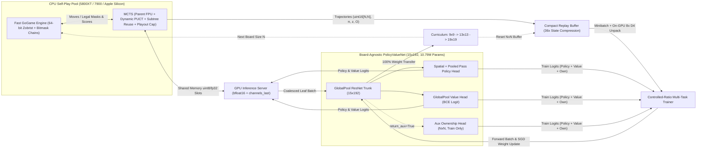

# OceanGo V2: Board-Agnostic Global-Pooling Architecture & MCTS Mathematical Guide

This document details the mathematical foundations, neural network architecture, fast incremental Go engine, Monte Carlo Tree Search (MCTS) optimizations, and reinforcement learning curriculum powering **OceanGo V2**.

OceanGo V2 combines **DeepMind's AlphaGo Zero / AlphaZero** self-play framework with key **KataGo** sample-efficiency innovations so a single consumer workstation (e.g., **Ryzen 7 5800XT + RTX 5060 Ti 16GB**, **Ryzen 9 7900 + RTX 5090**, or **Apple Silicon Mac**) can train progressively across **`9x9` $\to$ `13x13` $\to$ `19x19`** with **100% weight transfer**.

---

## 1. High-Level System Architecture

---

## 2. Fast Incremental Go Engine (`GoGame`)

Evaluating MCTS leaves on `19x19` requires tens of thousands of legality, capture, and positional superko checks per second across CPU workers. OceanGo V2 eliminates Python BFS scans and byte-string board hashing via three exact data structures:

1. **64-Bit Zobrist Hashing**:
   - Deterministic 64-bit Zobrist keys $Z(c, p)$ are precomputed per color $c \in \{1, 2\}$ and board index $p \in [0, N^2 - 1]$.
   - Each connected stone chain stores its cumulative XOR hash $Z(C) = \bigoplus_{s \in C} Z(c, s)$.
   - Placing a stone or capturing a 50-stone dragon updates `board_hash` in $O(1)$ integer XOR operations, storing positional superko `history` as a compact `set[int]`.
2. **Immutable Bitmask Stone Chains ($O(1)$ Legality & Liberties)**:
   - Each chain is represented as an immutable 4-tuple `(color, stones_mask, neighbor_mask, zobrist_hash)` where `stones_mask` and `neighbor_mask` are Python arbitrary-precision `int` bitsets (up to 361 bits).
   - Because `empty_mask` tracks all empty intersections on the board, the exact liberty bitmask of *any* chain $C$ at any instant is simply:
     $$\text{libs}(C) = \text{neighbor\_mask}(C) \ \& \ \text{empty\_mask}$$
   - `GoGame.copy()` performs a shallow pointer slice of immutable chain tuples, while `get_legal_moves()` tests suicide, multi-group captures, and positional superko in $O(1)$ bitwise operations per empty point without mutating or copying the board.
3. **Unified Chinese Area Scoring & Ownership Targets**:
   - `auto_detect_dead_stones()` identifies trapped low-liberty and eye-less enclosed groups and is wired directly into `get_winner()`, ensuring MCTS terminal values match interactive UI scoring (`7.5` Komi).
   - `get_ownership_target()` produces an exact $(N, N)$ map ($1.0$ = current player point, $0.0$ = opponent point, $0.5$ = neutral dame) at double-pass game end.

---

## 3. Input Representation: 18 Canonical Feature Planes

OceanGo V2 feeds the network a canonical tensor of shape $[18 \times N \times N]$ from the perspective of the player to move:

| Plane Index | Description | Purpose |
|:---:|:---|:---|
| **0 – 7** | Current player stones for time steps $t, t-1, \dots, t-7$ | Tactical history, recent captures, and ko state |
| **8 – 15** | Opponent stones for time steps $t, t-1, \dots, t-7$ | Reciprocal historical context |
| **16** | Constant $1.0$ if Black to move, $0.0$ if White to move | Komi ($7.5$) and turn-color awareness |
| **17** | **Constant $1.0$ on-board area mask** | Allows zero-padded $3 \times 3$ convolutions to distinguish edges & corners at every depth across $9\times 9$, $13\times 13$, and $19\times 19$ |

---

## 4. Board-Size-Agnostic Global-Pooling ResNet (`PolicyValueNet`)

Traditional AlphaGo Zero networks flatten spatial feature maps into fixed `Linear(N*N, ...)` layers, locking weights to a single board size. OceanGo V2 replaces all fixed-dimension layers with **KataGo Global-Pooling (`KataGlobalPool`)**, making **100% of parameters independent of $N$**.

### `KataGlobalPool` Layer
Given a feature tensor $X \in \mathbb{R}^{B \times C \times N \times N}$, `KataGlobalPool` computes channel-wise statistics scaled relative to board size $N$:
$$\mu_c = \frac{1}{N^2}\sum_{i,j} X_{c,i,j}, \qquad s(N) = \frac{N - 14.0}{10.0}, \qquad m_c = \max_{i,j} X_{c,i,j}$$
$$\text{KataGlobalPool}(X) = \big[\,\mu,\; s(N)\cdot \mu,\; m\,\big] \in \mathbb{R}^{B \times 3C}$$
Notice $s(9) = -0.5$, $s(13) = -0.1$, and $s(19) = +0.5$, explicitly informing global value and pass heads how $7.5$ Komi and stone counts scale with board area.

### Residual Backbone (`default: 15 blocks × 192 channels`)
- Standard $3\times 3$ `ResBlock`s alternate with a `GlobalPoolResBlock` every 3rd block (`blocks 3, 6, 9, 12, 15`), injecting whole-board territory, liberty, and ladder context back into spatial trunk channels at every stage.

### Three Board-Size-Agnostic Output Heads
1. **Policy Head $\to (B, N^2 + 1)$**:
   - Spatial branch ($1\times 1\text{ Conv } C \to 32 + \text{BN}$) + global context bias (`KataGlobalPool` $\to \text{Linear}(96 \to 32)$) $\to \text{ReLU} \to 1\times 1\text{ Conv}(32 \to 1)$ producing $(B, N^2)$ board move logits.
   - Pooled **Pass** branch: $\text{Linear}(96 \to 1)$ concatenated to form $(B, N^2 + 1)$.
2. **Value Head $\to (B, 1)$**:
   - $1\times 1\text{ Conv}(C \to 32) + \text{BN} + \text{ReLU} \to \text{KataGlobalPool }(B, 96) \to \text{Linear}(96 \to 256) + \text{ReLU} \to \text{Linear}(256 \to 1)$ outputting raw win-rate logit $u$.
   - Inference maps $u$ to $[-1, +1]$ via the exact identity:
     $$v = 2\sigma(u) - 1 = \tanh(0.5\,u) \in [-1, +1]$$
3. **Auxiliary Ownership Head $\to (B, N, N)$**:
   - $1\times 1\text{ Conv}(C \to 32) + \text{BN} + \text{ReLU} \to 1\times 1\text{ Conv}(32 \to 1)$ outputting per-intersection ownership logits. Evaluated **only during training** (or live `[O]` UI visualization), adding **zero** MCTS inference overhead.

---

## 5. MCTS Search & Self-Play Optimizations

### 1. Parent-Relative First-Play Urgency (FPU) & Dynamic PUCT
Setting $Q = 0$ for unvisited moves forces MCTS in losing positions ($-Q_{\text{parent}} < 0$) to waste visits scanning every legal intersection once before searching deeper. OceanGo V2 uses **Parent-Relative FPU** and **Dynamic PUCT**:
$$c_{\text{puct}}(s) = c_{\text{init}} + \ln\!\left(\frac{1 + N(s) + c_{\text{base}}}{c_{\text{base}}}\right)$$
$$Q_{\text{FPU}}(s) = V(s) - c_{\text{fpu}}\sqrt{\sum_{b:\,N(s,b)>0} P_{\text{raw}}(s, b)}$$
with $c_{\text{fpu}} = 0.20$ at internal nodes and $c_{\text{fpu}} = 0.0$ at Dirichlet-noised root nodes.

### 2. Pass-Safe Root Dirichlet Noise & Subtree Reuse
- Root Dirichlet noise ($\epsilon = 0.25$, $\alpha \in \{0.15, 0.06, 0.03\}$) is restricted strictly to **board moves** whenever legal board moves exist, keeping `Pass` at its clean neural prior so noise never triggers premature double-passes.
- Clean neural priors `raw_P` are stored separately from noised `P`, allowing MCTS subtrees (`root = root.children[move]`) to be reused across moves in both self-play and interactive `--play`.

### 3. Decoupled Soft Policy Targets vs. Smooth Temperature Decay
- Training targets $\boldsymbol{\pi}_{\text{target}}$ always record normalized visit counts $N(s,a)/\sum_b N(s,b)$ (with single-visit low-prior noise pruning), preserving rich multi-candidate supervision throughout the middlegame and endgame.
- Self-play move selection independently applies smooth temperature decay ($1.0 \to 0.5 \to 0.15 \to \text{greedy}$).

### 4. KataGo Playout Cap Oscillations & Calibrated Resignation
- **Playout Cap Randomization**: `25%` of self-play turns run a **full search** (`--sims`, Dirichlet ON, `policy_weight = 1.0`), while `75%` run a **fast search** (`~20%` of `--sims`, min `80`, Dirichlet OFF, `policy_weight = 0.0`), increasing game generation throughput by **~2.5x–3x**.
- **Calibrated Resignation + Full-Playout Gate**: Games resign when both root and best-child values stay below $-0.90$ for `5` consecutive plies. Resignation is **disabled in `25%` of games** (`playout_full_game = True`) so those games play cleanly to double-pass—supplying exact `ownership` supervision (`ownership_weight = 1.0`), sharpening pass play, and measuring the exact false-resignation rate.

---

## 6. Non-Saturating Multi-Task Loss & Controlled Replay Ratio

Replacing `tanh + MSE` with `BCEWithLogitsLoss` cancels the $\sigma'(u)$ saturation derivative analytically, eliminating dead value gradients near $\pm 1$:

$$\mathcal{L}(\theta) = \mathcal{L}_{\text{policy}}(\text{masked CE}) + 1.2\,\mathcal{L}_{\text{value}}(\text{BCEWithLogits}) + 0.5\,\mathcal{L}_{\text{ownership}}(\text{masked BCEWithLogits}) + 10^{-4}\|\theta_{\text{conv/fc}}\|_2^2$$

- **Selective Weight Decay**: $10^{-4}$ L2 regularization is applied strictly to `Conv2d` and `Linear` weights (`ndim >= 2`), excluding BatchNorm scales and biases.
- **Controlled Replay Ratio**: Gradient updates per iteration scale proportionally to newly generated self-play positions (`--replay-ratio 1.5`) rather than over-training fixed epochs over the entire buffer.

---

## 7. Bit-Packed Replay Buffer, GPU 8x Symmetry & Shared-Memory IPC

1. **Bit-Packed `uint16[N, N]` Replay Buffer**:
   - Packs all 16 binary stone history planes into a single `uint16[N, N]` matrix (`722 bytes` instead of `24.5 KB` on `19x19` — **34x RAM reduction**), keeping `500,000` unique `19x19` states (~4M symmetric views) under **~0.95 GB RAM**.
   - Stratified 8-fold $D_4$ dihedral rotations and reflections (`torch.rot90` / `torch.flip`) and bit-unpacking run **on-the-fly directly on the GPU** per minibatch.
2. **Zero-Pickle Shared-Memory Worker Slots (`multiprocessing.shared_memory`)**:
   - CPU self-play workers write `uint8` leaf planes directly into pre-allocated shared-memory slots and pass tiny `(worker_id, count)` descriptors to the central GPU server thread, eliminating Windows/macOS `spawn` pipe-pickling bottlenecks across 16–32+ workers.
3. **Blackwell / Apple Silicon Acceleration**:
   - Uses native `torch.bfloat16` Tensor Core autocast without `GradScaler` overhead on modern NVIDIA GPUs (`RTX 5060 Ti`, `RTX 5090`, `RTX 40/30` series) and Apple Silicon `MPS`, paired with `channels_last` memory format and optional `--compile`.
